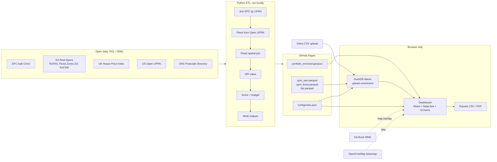

# ARCHITECTURE.md — RiskLens Portfolio

## 1. Overview



There are two paths through the system:

- **Demo path:** the ETL pre-enriches a synthetic portfolio into GeoJSON, and the dashboard loads it on page open.
- **Upload path:** a prospect drops a CSV, DuckDB-Wasm joins it against the Parquet lookups in the browser, and the dashboard re-renders. Only UPRNs and postcodes inside the demo areas are covered. Rows outside them are flagged "not covered in demo".

There is no server, no database and no API key anywhere.

## 2. Data sources

All sources are open data (OGL unless noted). Download raw files to `data/raw/<source>/` by hand or with a script, and record the download date in `data/raw/MANIFEST.md`.

| Source | Files used | Key fields | Licence / notes |
| --- | --- | --- | --- |
| EPC register, get-energy-performance-data.communities.gov.uk | Domestic `certificates.csv` + `recommendations.csv` (filtered to the demo LAs); non-domestic national zip of yearly `certificates-YYYY.csv` + `recommendations-YYYY.csv`, filtered to demo LAs in the ETL | See §3.1 | OGL for certificate data. Free GOV.UK One Login sign-in. Drop all address columns on load. |
| EA Risk of Flooding from Rivers and Sea (RoFRS, NaFRA2) | Polygons fetched by LA bounding box from the Defra OGC API Features service (`00_fetch_raw.py`), clipped to demo areas | `risk_band` | OGL |
| EA Flood Map for Planning, Flood Zones 2 and 3 | Polygons, fetched the same way | `flood_zone` (FZ2/FZ3) | OGL |
| EA Risk of Flooding from Surface Water (RoFSW, NaFRA2) | Polygons, fetched the same way, clipped | `risk_band` (high/medium/low; no very low) | OGL |
| UK House Price Index | Full CSV | region/LA code, date, average price by property type | OGL |
| OS Open UPRN | CSV (GB) | UPRN, X/Y (EPSG:27700), lat, long; no LA field, so assigned by point-in-polygon | OGL |
| ONS Postcode Directory (ONSPD) | CSV | pcds, lat, long, lsoa21cd, lad26cd (the LA column was `oslaua` in older releases), doterm | OGL; also contains Royal Mail, Gridlink, LPS, OS and ONS IPR (confirm the attribution wording from the user guide) |
| OpenStreetMap via OpenFreeMap | Vector tiles (runtime) | basemap | ODbL; show attribution |
| ONS Local Authority District boundaries (May 2026, BGC) | GeoJSON for the demo LAs (`00_fetch_raw.py`) | LAD26CD, LAD26NM | OGL; contains OS data |
| EA flood WMS | Runtime map overlay only | — | OGL |

**Excluded:** HM Land Registry Price Paid Data (address-data restrictions) and any paid or keyed service.

## 3. Data schemas

### 3.1 EPC input mapping (`etl/config/epc_columns.yaml`)

Raw headers vary between releases, so map them in config. Headers seen in the November 2026 release:

| Internal | Domestic header | Non-domestic header |
| --- | --- | --- |
| lmk_key | certificate_number | certificate_number |
| uprn | uprn | uprn |
| postcode | postcode | postcode |
| la_code | local_authority | local_authority |
| band_current | current_energy_rating | asset_rating_band |
| score_current | current_energy_efficiency | asset_rating |
| band_potential | potential_energy_rating | (none) |
| floor_area_m2 | total_floor_area | floor_area |
| property_type | property_type | property_type |
| tenure | tenure | (none) |
| lodgement_date | lodgement_date | lodgement_date |

Earlier releases used upper-case headers and `LMK_KEY`. The internal name stays `lmk_key`.

Notes on the raw values:

- Non-domestic bands include `A+`. `band_aliases` in `epc_columns.yaml` maps it to `A`.
- Domestic tenure values are lower-cased, and "unknown" becomes null.
- Only mapped columns are read, so address columns are never loaded. Any output column matching `forbidden_column_patterns` fails the run.

Recommendations:

- **Domestic** files give `certificate_number, improvement_item, improvement_summary_text, indicative_cost`, mapped to `lmk_key, improvement_item, summary, indicative_cost`. Cost is a text range such as "£100 - £350", with inconsistent currency symbols. The ETL takes the one or two numbers and parses them to `cost_low`, `cost_high` and `cost_mid`.
- **Non-domestic** files give `certificate_number, recommendation_item, recommendation, payback_type`. They carry **no cost**, so commercial costs fall back to `fallback_upgrade_cost_gbp.commercial`.

Keep only the latest certificate per **(UPRN, use)** (max `lodgement_date`, ties broken by `lmk_key`). Some UPRNs carry both a domestic and a non-domestic certificate. Certificates without a UPRN are excluded from the per-UPRN table. An EPC is valid for 10 years (`rules.json` `data_quality.epc_valid_years`), so flag `epc_expired` when `lodgement_date` is more than 10 years before `rules.json` `as_of`. A certificate lodged exactly 10 years before is still valid.

### 3.2 Portfolio CSV (demo sample and client upload)

| Column | Type | Required | Notes |
| --- | --- | --- | --- |
| asset_id | string | yes | e.g. `RL-0001` |
| uprn | string | preferred | numeric string |
| postcode | string | if no UPRN | normalised to `pcds` format |
| use | enum `residential` \| `commercial` | yes | |
| tenure | enum `rented` \| `owner_occupied` | yes | MEES applies only to rented |
| floor_area_m2 | number | optional | falls back to EPC value |
| value_gbp | number | optional | overrides the HPI estimate |

### 3.3 Enriched asset (GeoJSON feature properties, TS type `Asset`)

```ts
interface Asset {
  asset_id: string;
  uprn: string | null;
  postcode: string | null;
  la_code: string; la_name: string;
  use: 'residential' | 'commercial';
  tenure: 'rented' | 'owner_occupied';
  match_level: 'uprn' | 'postcode' | 'none';
  epc: {
    band_current: Band | null; band_potential: Band | null;
    score_current: number | null; floor_area_m2: number | null;
    lodgement_date: string | null; expired: boolean;
  };
  flood: {
    rofrs: 'high' | 'medium' | 'low' | 'very_low' | 'none';
    zone: '3' | '2' | 'none';
    rofsw: 'high' | 'medium' | 'low' | 'very_low' | 'none';
  };
  compliance: { failing_rule_id: string | null; deadline: string | null; status: 'compliant' | 'fails_future' | 'fails_current' | 'no_epc' };
  scores: { compliance: 0 | 50 | 100; flood: 0 | 50 | 100; data_quality: 0 | 50 | 100; total: number };
  tier: 'low' | 'watch' | 'act';
  recommendations: { summary: string; cost_low: number | null; cost_high: number | null }[]; // top 3
  upgrade_cost_mid_gbp: number | null;
  value_gbp: number | null; value_source: 'client' | 'hpi' | null;
}
type Band = 'A' | 'B' | 'C' | 'D' | 'E' | 'F' | 'G';
```

Geometry is a point taken from OS Open UPRN, or the ONSPD postcode centroid when there's no UPRN.

### 3.4 Static lookups for the upload path (`web/public/data/`)

| File | Columns | Purpose |
| --- | --- | --- |
| `uprn_epc.parquet` | uprn, postcode, la_code, use, band_current, band_potential, score_current, floor_area_m2, lodgement_date, property_type, top3_recs (JSON string), upgrade_cost_mid (sum of all recs' cost_mid), rec_costs_mid (JSON list) | EPC by (UPRN, use) |
| `uprn_flood.parquet` | uprn, lat, lon, la_code, rofrs, zone, rofsw | flood bands + location + LA by UPRN, for every UPRN in demo areas |
| `postcode_lookup.parquet` | postcode, lat, lon, la_code, rofrs, zone, rofsw (worst over the postcode centroid and EPC-located UPRNs in the postcode), median_band_residential, median_lodgement_residential, median_band_commercial, median_lodgement_commercial | postcode-level fallback (median band by rank; the worse middle value for even counts) |
| `hpi.parquet` | la_code, property_type, avg_price, month | latest month only |

Target a total size under 25 MB. If the files are larger, reduce the demo areas.

## 4. Rules and scoring (`web/public/config/rules.json`)

```json
{
  "as_of": "2026-11-09",
  "rules": [
    { "id": "dom_mees_current", "use": "residential", "tenure": "rented", "min_band": "E", "deadline": null, "status": "in_force" },
    { "id": "dom_mees_2030", "use": "residential", "tenure": "rented", "min_band": "C", "deadline": "2030-10-01", "status": "confirmed_policy", "note": "EPC C or equivalent; new EPC metrics may change the mapping" },
    { "id": "nondom_mees_current", "use": "commercial", "tenure": "rented", "min_band": "E", "deadline": null, "status": "in_force" },
    { "id": "nondom_mees_2031", "use": "commercial", "tenure": "rented", "min_band": "B", "min_floor_area_m2": 1000, "deadline": "2031-01-01", "status": "announced", "note": "Where cost-effective; subject to secondary legislation; exact date TBC" }
  ],
  "weights": { "compliance": 0.5, "flood": 0.35, "data_quality": 0.15 },
  "tiers": { "watch": 30, "act": 60 },
  "data_quality": { "epc_fresh_years": 5, "epc_valid_years": 10 },
  "fallback_upgrade_cost_gbp": { "residential": "TODO", "commercial": "TODO" }
}
```

Scoring:

- **compliance**
  - 100: fails a rule with `deadline: null` (current minimum), or has no EPC / an expired EPC while rented.
  - 50: fails only a future rule.
  - 0: compliant, or `owner_occupied`.
- **flood**
  - 100: RoFRS high, or Zone 3, or RoFSW high.
  - 50: RoFRS medium or low, or Zone 2, or RoFSW medium.
  - 0: everything else.
- **data_quality**
  - 0: matched by UPRN and EPC under 5 years old.
  - 50: postcode-level match, or EPC 5–10 years old.
  - 100: no match, or expired.
- **total** = round(0.5·C + 0.35·F + 0.15·D), rounding .5 **up**. Compute it as integers, `floor((50·C + 35·F + 15·D + 50) / 100)`, so Python and TypeScript agree (Python's `round(42.5)` is 42). Tier: below 30 is low, 30–59 is watch, 60+ is act.
- **upgrade_cost_mid_gbp**
  - 0 for compliant (and owner-occupied) assets.
  - For assets failing a rule, the sum of `cost_mid` over all the certificate's recommendations.
  - If none are available (and always for `no_epc`), use the fallback from config. If the fallback is `TODO`, the value is null and the UI shows "cost unknown".
- **Rules with `min_floor_area_m2`** apply only when the floor area is known and at least that size.
- **Data-quality age** is measured against `as_of`. "Under 5 years" means lodged strictly after `as_of` minus 5 years.
- **Shared fixture:** the cases in `etl/tests/fixtures/scoring_cases.json` are hand-checked, and both pytest and vitest run them.

The 2031 date is a placeholder for "2031". Display it as "2031", not a specific day.

## 5. ETL pipeline (`etl/scripts/`)

| Step | Script | Output |
| --- | --- | --- |
| 0 | `00_fetch_raw.py` | LA boundaries + EA flood layers by bbox into `data/raw/` (one-off; not part of `run_all.py`) |
| 1 | `01_load_epc.py` | `processed/epc_latest.parquet` (address columns never read, latest per (UPRN, use)), `processed/recs.parquet` |
| 2 | `02_load_flood.py` | clipped flood layers as GeoParquet, reprojected to EPSG:27700 for joins |
| 3 | `03_load_locations.py` | Open UPRN + ONSPD filtered to demo LAs |
| 4 | `04_flood_join.py` | `uprn_flood.parquet` (spatial join of UPRN points to each flood layer; worst band wins) |
| 5 | `05_hpi.py` | `hpi.parquet` |
| 6 | `06_sample_portfolio.py` | `portfolio_sample.csv` (180 rows, fixed random seed, ~40% below C) |
| 7 | `07_enrich_score.py` | `portfolio_enriched.geojson` (EPSG:4326), plus `uprn_epc.parquet` and `postcode_lookup.parquet` |
| — | `run_all.py` | runs 1–7 and copies outputs to `web/public/data/` |

## 6. Front end (`web/src/`)

```
src/
├── main.tsx, App.tsx
├── config/brand.ts            # name, accent colour, logo text
├── types.ts                   # Asset, Band, Rules (mirror §3–4)
├── lib/
│   ├── loadData.ts            # fetch GeoJSON + rules.json
│   ├── scoring.ts             # mirror of Python scoring
│   ├── duck.ts                # DuckDB-Wasm init + upload join
│   ├── aggregate.ts           # KPI + chart aggregations
│   └── exportPdf.ts, exportCsv.ts
├── state/portfolioStore.ts    # assets, filters, selected asset (Zustand or useReducer)
└── components/
    ├── Header.tsx             # brand, upload button, export menu
    ├── KpiRow.tsx             # assets, % below C, % in Zone 3, upgrade budget, value exposed
    ├── RiskMap.tsx            # MapLibre, tier-coloured points, layer toggles
    ├── BandChart.tsx          # EPC band distribution
    ├── ComplianceTimeline.tsx # non-compliant count: today, Oct 2030, 2031
    ├── Filters.tsx            # LA, use, band, tier
    ├── AssetTable.tsx         # sortable, click opens drawer
    ├── AssetDrawer.tsx        # bands, failing rule, flood bands, top 3 recs + costs
    ├── UploadDialog.tsx       # sample CSV link, validation errors
    └── Footer.tsx             # disclaimer + attributions
```

Layout:

- **Desktop:** header, then the KPI row, then the map (60%) beside the charts (40%), then the table.
- **Mobile:** sections stack, and the map is 50vh.

Map details:

- **Map points:** circle layer coloured by tier, with radius scaled lightly by value.
- **Flood toggles** add EA WMS raster sources (RoFRS, Flood Zones, RoFSW). Look up the current WMS endpoint URLs on environment.data.gov.uk and keep them in `config/brand.ts` or a `layers.ts`.

**Upload flow (`duck.ts`):**

1. Papa Parse the CSV.
2. Validate it against §3.2.
3. Register the rows as a DuckDB table.
4. Run `LEFT JOIN` against `read_parquet('data/uprn_epc.parquet')` and `uprn_flood.parquet` on uprn, falling back to `postcode_lookup.parquet`.
5. Score in TS.
6. Replace the store's assets.

Show a summary: X matched by UPRN, Y by postcode, Z not covered.

## 7. Attribution and disclaimer (footer, also in the PDF)

> Indicative screening only. Not a valuation, flood risk assessment or legal advice. Data may be out of date for individual properties.
>
> Contains public sector information licensed under the Open Government Licence v3.0, including EPC data (MHCLG), Environment Agency flood data, UK House Price Index (HM Land Registry, ONS), ONS Postcode Directory and OS Open UPRN (© Crown copyright and database right). Map data © OpenStreetMap contributors, tiles by OpenFreeMap.

## 8. Deployment

- GitHub Actions: build `web/` and publish `web/dist` to GitHub Pages.
- Set the Vite `base` to the repo name.
- Serve the `.parquet` files as static assets. Check that DuckDB-Wasm loads them over HTTP range requests on Pages.

## 9. Performance budgets

- First load under 3 s on desktop broadband.
- GeoJSON under 1 MB.
- DuckDB-Wasm lazy-loaded only when the user opens the upload dialog.
- An upload of 500 rows is enriched in under 5 s.
