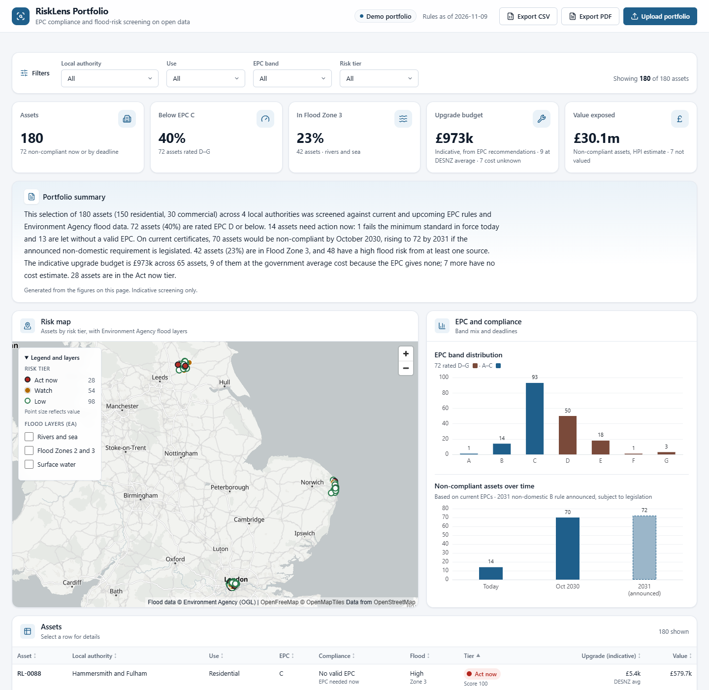

# RiskLens Portfolio

**EPC compliance and flood-risk screening for UK property portfolios, built entirely on open data.**

[](https://github.com/Surabhi3011/risklens-portfolio/actions/workflows/deploy.yml)

**Live demo:** https://surabhi3011.github.io/risklens-portfolio/

RiskLens Portfolio takes a landlord's list of properties and shows, in one dashboard:

- which assets fail the current minimum EPC standard, or will fail upcoming ones (October 2030 for rented homes; 2031 for larger rented non-domestic buildings, announced but not yet legislated);
- which assets sit in Environment Agency flood-risk areas (rivers and sea, Flood Zones 2 and 3, surface water);
- a rough, **indicative** upgrade budget built from the recommendations on each EPC.

It is a client-acquisition demo. "RiskLens Portfolio" is a fictional working name, configurable in `web/src/config/brand.ts`.



## What you can do

- **Explore the demo portfolio.** 180 synthetic assets built from real EPC records in four local authorities: York, Great Yarmouth, Westminster, and Hammersmith and Fulham.
- **Filter** by local authority, use, EPC band and risk tier. The KPIs, map, charts, summary and table all update together.
- **Map:** risk tiers on an OpenStreetMap basemap, with optional Environment Agency flood overlays.
- **Asset drawer:** current and potential EPC band, the failing rule and its deadline, flood bands, the top three recommendations with indicative costs, and the age of the EPC.
- **Upload your own CSV.** It is matched and scored **in your browser** with DuckDB-Wasm, and nothing is sent to a server. Use the sample file in the upload dialog as a template.
- **Export** the current selection as a CSV, or as a one-page PDF summary.

Risk tiers (Act now, Watch, Low) combine compliance (50%), flood (35%) and data quality (15%). The weights, deadlines and thresholds live in `web/public/config/rules.json`. Tiers are never shown by colour alone.

## How it works

```
Open data (OGL) ──► Python ETL (run locally) ──► static files in web/public/data ──► React dashboard on GitHub Pages
                                                         └──► DuckDB-Wasm joins uploaded CSVs in the browser
```

- **No backend:** no servers, databases, API keys or secrets. GitHub Pages serves the site as static files.
- **ETL** (`etl/`, Python): loads EPC certificates, joins them to UPRN locations, spatially joins each UPRN to the flood layers, adds UK HPI values, scores each asset, and writes the published files. Address columns are never read, and published files contain no addresses.
- **Dashboard** (`web/`, Vite + React + TypeScript): MapLibre GL JS for the map, ECharts for the charts, DuckDB-Wasm for uploads, and jsPDF for the PDF export.
- **Scoring parity:** the same scoring runs in Python (`etl/risklens_etl/scoring.py`) and TypeScript (`web/src/lib/scoring.ts`), and both are tested against one shared fixture (`etl/tests/fixtures/scoring_cases.json`).

See [ARCHITECTURE.md](ARCHITECTURE.md) for schemas and scoring rules, and [docs/verification.md](docs/verification.md) for the spot-checks, Lighthouse scores and deployment checks.

## Data sources and licences

All data is open. Downloads are recorded with dates and checksums in [`data/raw/MANIFEST.md`](data/raw/MANIFEST.md).

| Source | Used for | Licence |
| --- | --- | --- |
| [EPC register](https://get-energy-performance-data.communities.gov.uk/) (MHCLG): domestic and non-domestic certificates and recommendations | EPC bands, scores, floor areas, recommendations and costs | Open Government Licence v3.0 (certificate data) |
| Environment Agency: Risk of Flooding from Rivers and Sea, Flood Map for Planning (Flood Zones 2 and 3), Risk of Flooding from Surface Water | Asset flood bands (ETL) and map overlays (WMS) | Open Government Licence v3.0 |
| [UK House Price Index](https://www.gov.uk/government/collections/uk-house-price-index-reports) (HM Land Registry, ONS) | Indicative residential values | Open Government Licence v3.0 |
| [OS Open UPRN](https://osdatahub.os.uk/downloads/open/OpenUPRN) (Ordnance Survey) | UPRN locations | Open Government Licence v3.0 |
| [ONS Postcode Directory](https://geoportal.statistics.gov.uk/) | Postcode locations and LA codes | Open Government Licence v3.0 |
| ONS Local Authority District boundaries | Clipping to demo areas | Open Government Licence v3.0 |
| OpenStreetMap via [OpenFreeMap](https://openfreemap.org) | Basemap | ODbL; © OpenStreetMap contributors |

HM Land Registry Price Paid Data is deliberately **not** used, because its address fields carry third-party restrictions.

> Contains public sector information licensed under the Open Government Licence v3.0, including EPC data (MHCLG), Environment Agency flood data, UK House Price Index (HM Land Registry, ONS) and OS Open UPRN. Contains OS data © Crown copyright and database right 2026. Contains Royal Mail data © Royal Mail copyright and database right 2026. Source: Office for National Statistics licensed under the Open Government Licence v.3.0 (ONS Postcode Directory, local authority boundaries). Map data © OpenStreetMap contributors, tiles by OpenFreeMap.

## Running it yourself

### Web app

Requires Node 24.

```bash
cd web
npm ci
npm run dev        # http://localhost:5173
npm test           # vitest, including Python/TS scoring parity
npm run lint && npm run typecheck
npm run build && npm run preview
```

The published data in `web/public/data/` is committed, so the app runs without the ETL.

### ETL (rebuilding the data)

Requires Python 3.11+ and [uv](https://docs.astral.sh/uv/).

1. **Download the EPC bulk files** by hand from the [EPC register](https://get-energy-performance-data.communities.gov.uk/). This needs a free GOV.UK One Login. Put the domestic `certificates.csv` and `recommendations.csv` in `data/raw/epc/domestic/`, and the non-domestic zip in `data/raw/epc/non_domestic/`.
2. **Download the national files** into their own folders in `data/raw/`: OS Open UPRN, the ONS Postcode Directory and the UK HPI full file. The URLs are in `data/raw/MANIFEST.md`.
3. **Fetch the LA boundaries and flood layers** for the demo areas. They are requested natively in British National Grid, EPSG:27700.
4. **Run the pipeline.**

```bash
cd etl
uv sync
uv run python scripts/00_fetch_raw.py      # boundaries + EA flood layers (step 3)
uv run python scripts/run_all.py           # steps 01-07, then copies outputs to web/public/data/
uv run pytest
```

`run_all.py` finishes with publish checks: no address columns or address-like text, GeoJSON under 1 MB, and Parquet under 25 MB. Demo areas are set in `etl/config/areas.yaml`. The sample portfolio is kept stable between runs; pass `--resample` to `06_sample_portfolio.py` for a new one.

### Upload format

| Column | Required | Notes |
| --- | --- | --- |
| `asset_id` | yes | unique per row |
| `uprn` | preferred | digits only |
| `postcode` | if no UPRN | UK postcode |
| `use` | yes | `residential` or `commercial` |
| `tenure` | yes | `rented` or `owner_occupied`. EPC minimum standards apply to rented property. |
| `floor_area_m2` | no | overrides the EPC floor area |
| `value_gbp` | no | overrides the HPI estimate |

## Limitations

This is **indicative screening only**. It is not a valuation, a flood risk assessment or legal advice.

- **Demo areas only.** Uploads are matched only within York, Great Yarmouth, Westminster, and Hammersmith and Fulham. Other rows are reported as "not covered in demo".
- **The portfolio is synthetic.** It is a sample of real, private-rented EPC records, not a real landlord's holdings.
- **Upgrade costs are indicative.**
  - They are the midpoints of the cost ranges on the EPC recommendations, summed per asset.
  - Residential assets with no costed recommendations use the government average of £5,400 per property (DESNZ impact assessment, privately rented homes government response, January 2026). The dashboard labels these as a DESNZ average.
  - Non-domestic EPCs publish no costs, and there is no open per-building estimate (`fallback_upgrade_cost_gbp.commercial` is `TODO` in `rules.json`). Those assets show "cost unknown".
- **The 2031 non-domestic EPC B requirement is announced, subject to legislation.** The date is a placeholder and is shown as "2031" only. The October 2030 domestic EPC C deadline is confirmed policy, but new EPC metrics may change how "C" is measured.
- **EPCs can be out of date.**
  - The dashboard uses the latest certificate per property. Certificates older than 10 years count as expired.
  - Compliance timelines are based on current certificates.
- **Flood bands are screening-level.**
  - Each UPRN point takes the worst band of the polygons it falls in.
  - The EA's own map service can differ from the published vector data by about 2 m at polygon edges (see `docs/verification.md`).
- **Values are rough.**
  - Residential values are the local-authority UK HPI average (flat price for flats, the overall average otherwise), not property valuations.
  - Commercial assets have no open value source and are not valued.
- **Social housing is excluded** from the demo sample, because the domestic minimum EPC standard applies to private rented homes.

## Project docs

- [CLAUDE.md](CLAUDE.md): working rules for this project
- [ARCHITECTURE.md](ARCHITECTURE.md): data sources, schemas, scoring and deployment
- [PLAN.md](PLAN.md): build plan and status
- [docs/verification.md](docs/verification.md): EPC and flood spot-checks, Lighthouse scores and live checks

## Licence

The code is released under the [MIT License](LICENSE). The data is not covered by it: each dataset keeps its own licence, listed above.
